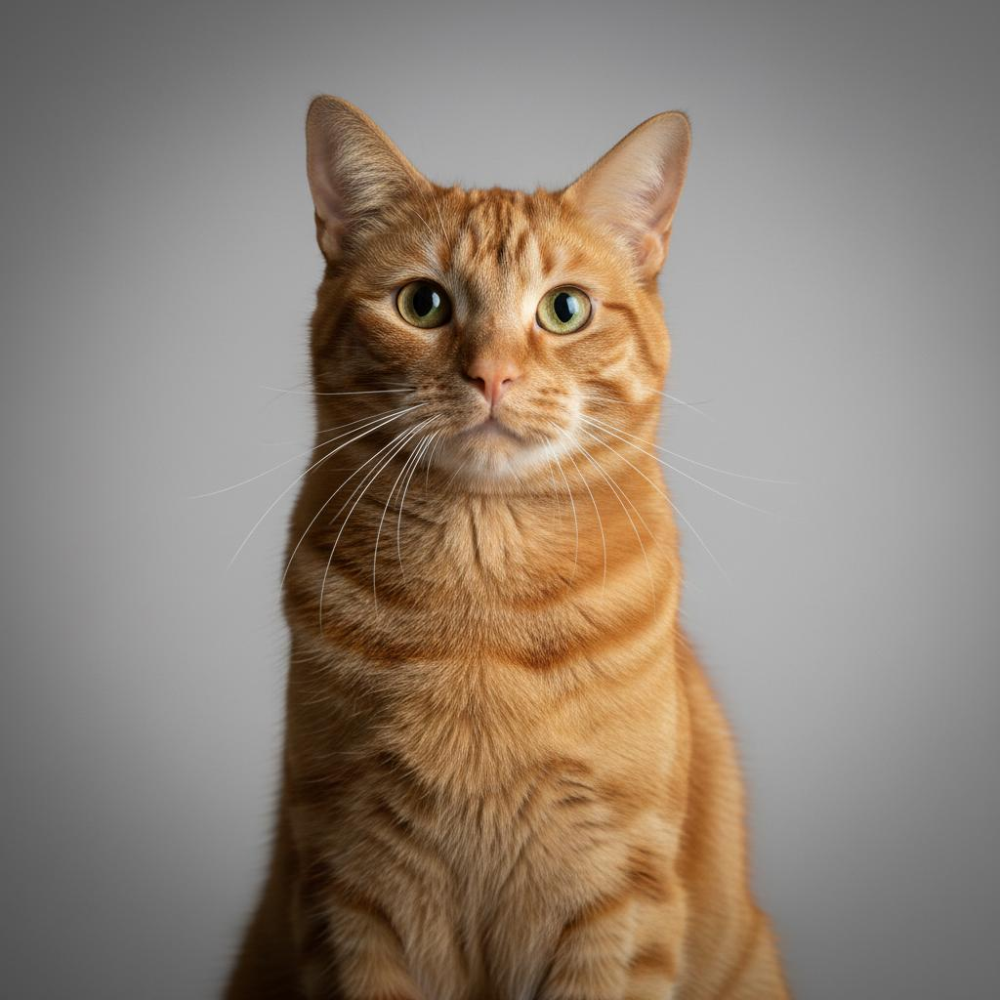
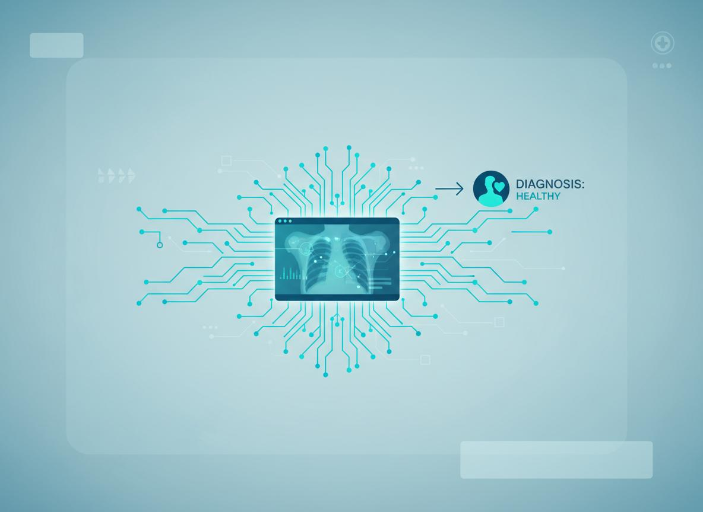
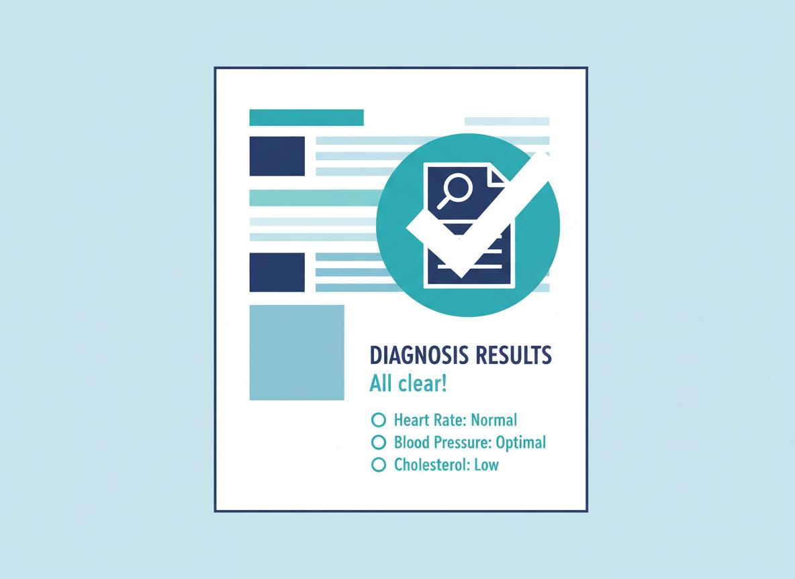
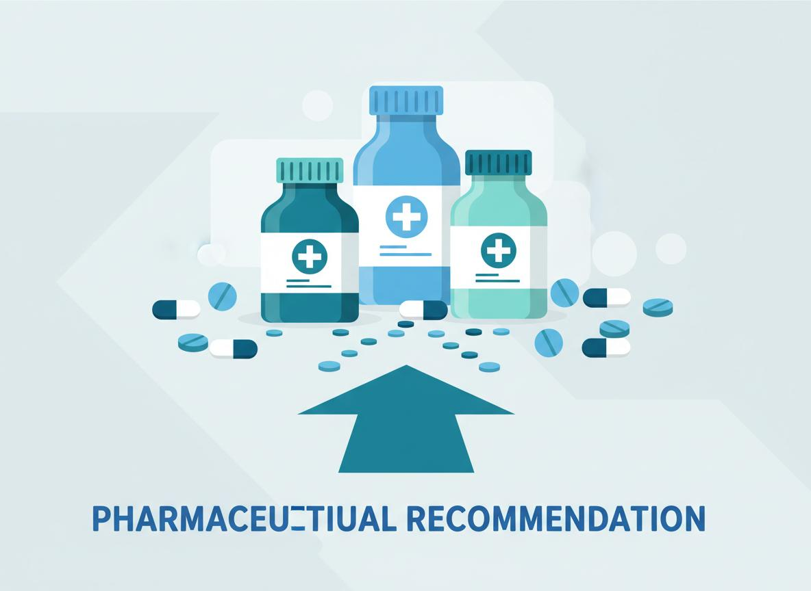
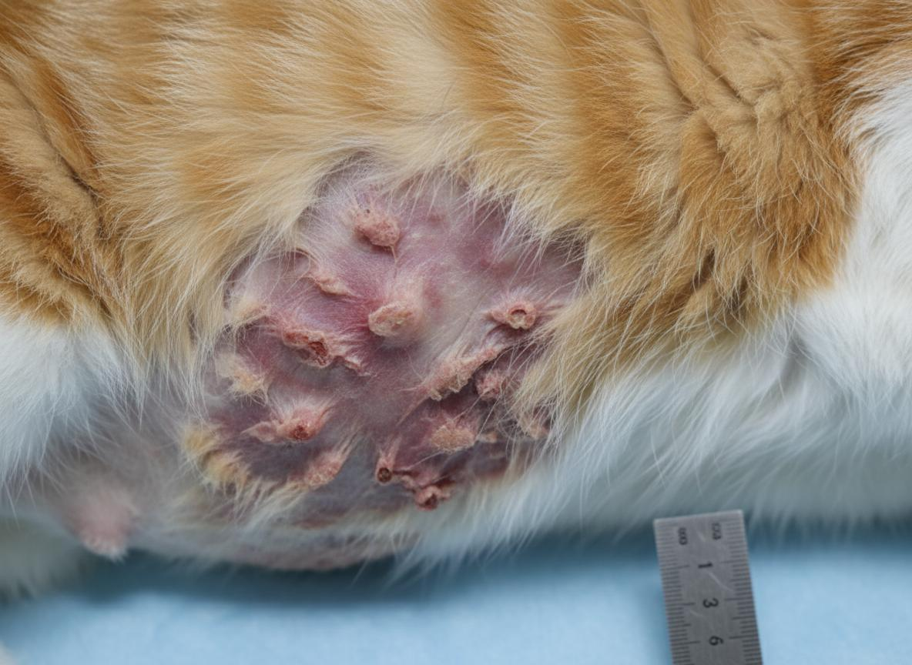
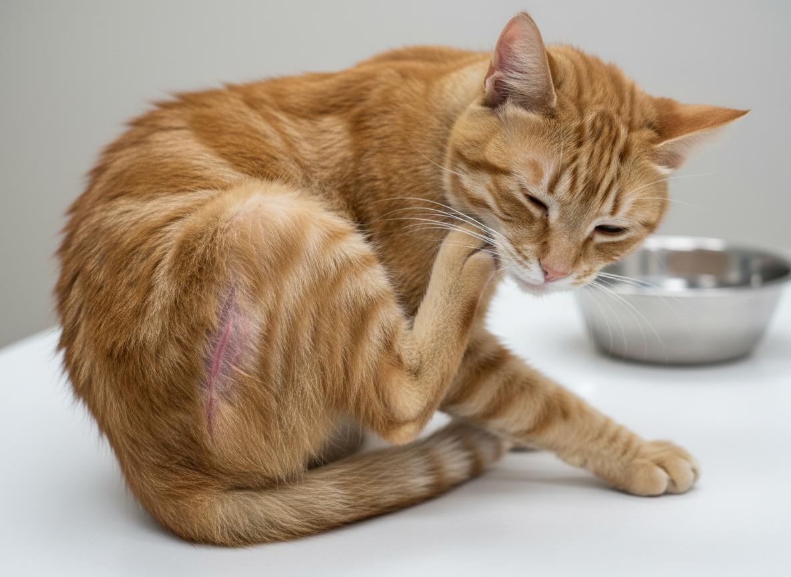
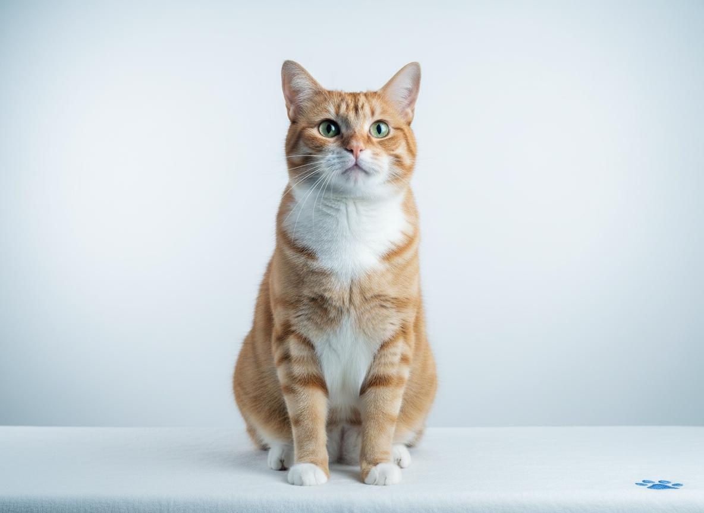
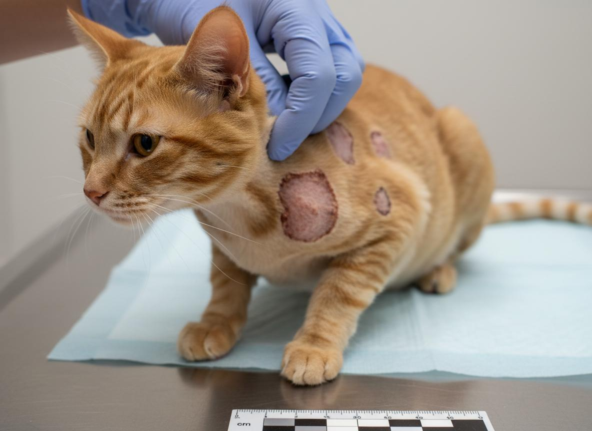
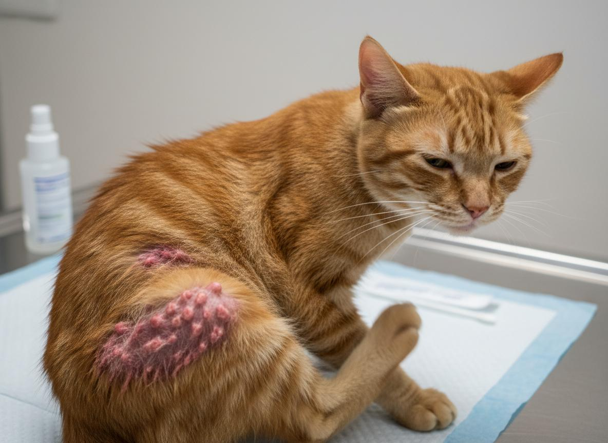

# 🐱 CatSkin AI - Frontend

<div align="center">

  

  <br /><br />

  [](https://catskin-ai-frontend.vercel.app)
  [](https://react.dev/)
  [](https://vitejs.dev/)
  [](https://tailwindcss.com/)
  [](LICENSE)

  <p align="center">
    <strong>Sistem Web Diagnosa Penyakit Kulit Kucing & Rekomendasi Terapi Pertolongan Pertama Menggunakan Convolutional Neural Network (CNN MobileNetV2)</strong>
  </p>

  <p align="center">
    <a href="#-fitur-utama">Fitur Utama</a> •
    <a href="#-panduan-penggunaan-untuk-pengguna">Cara Pakai</a> •
    <a href="#-alur-kerja-sistem">Alur Kerja</a> •
    <a href="#-kategori-penyakit-kulit-kucing">Kategori Penyakit</a> •
    <a href="#-instalasi--menjalankan-secara-lokal">Instalasi Lokal</a> •
    <a href="#-arsitektur-sistem">Arsitektur</a>
  </p>

</div>

---

## 📖 Tentang Proyek

**CatSkin AI** adalah aplikasi web kecerdasan buatan (*Artificial Intelligence*) yang dikembangkan untuk membantu pemilik kucing dan pecinta hewan mendeteksi indikasi penyakit kulit kucing secara dini serta memperoleh panduan edukasi penanganan awal medis sebelum dibawa ke klinik dokter hewan.

Sistem ini didukung oleh model pembelajaran mendalam (*Deep Learning*) arsitektur **MobileNetV2** yang telah dilatih menggunakan ratusan citra klinis teranotasi, menghasilkan klasifikasi akurat dengan **akurasi validasi 75.22%** pada 5 kondisi dominan kulit kucing.

> 🌐 **Website Resmi Siap Digunakan:**  
> Kunjungi dan gunakan langsung melalui: **[https://catskin-ai-frontend.vercel.app](https://catskin-ai-frontend.vercel.app)**

---

## ✨ Fitur Utama

- 📸 **Kamera Realtime (WebRTC HTTPS):** Ambil foto langsung menggunakan kamera smartphone atau webcam laptop dengan panduan kotak fokus (*reticle guide*) dan tombol pemutar kamera (depan/belakang).
- 📁 **Unggah dari Galeri / File:** Mendukung *drag and drop* atau pemilihan berkas foto berformat **JPG, PNG, dan WebP** (hingga ukuran 5MB).
- 🧠 **Diagnosa CNN MobileNetV2 Otomatis:** Mengklasifikasikan kondisi lesi kulit kucing secara instan dengan skor keyakinan (*confidence score*) serta visualisasi grafik distribusi probabilitas Softmax untuk ke-5 kelas.
- 💊 **Rekomendasi Terapi & Obat Medis:** Menyajikan langkah pertolongan pertama dan obat topikal/sistemik yang dirujuk dari pakar dokter hewan (**drh. Ismail Antarusmara**).
- 🛡️ **Validasi Citra AI (Anti-OOD / Non-Cat Rejection):** Proteksi cerdas berlapis untuk menolak gambar yang bukan kulit kucing (seperti manusia, perabotan, kendaraan, atau ruangan) guna mencegah kesalahan diagnosa (*Garbage-In Garbage-Out*).
- 📱 **Desain Responsif & Modern:** Tampilan elegan berbasis Tailwind CSS dan komponen Shadcn UI yang optimal diakses dari layar smartphone, tablet, maupun desktop.
- 🛠️ **Admin Dashboard Lengkap:** Panel internal untuk manajemen data latih, retraining model, deployment model baru, serta unduh rekap riwayat diagnosa.

---

## 🚀 Panduan Penggunaan (Untuk Pengguna Umum)

Menggunakan CatSkin AI sangat mudah, tanpa perlu registrasi akun atau biaya apa pun:

### Langkah 1: Buka Website
Buka browser Google Chrome atau Safari di HP / Laptop Anda, lalu akses **[catskin-ai-frontend.vercel.app](https://catskin-ai-frontend.vercel.app)**.

### Langkah 2: Pilih Metode Input Foto
Pilih salah satu dari 2 opsi input pada bagian **"Coba Diagnosa Sekarang"**:
1. **Ambil Foto Realtime (Kamera):**
   * Izinkan akses kamera saat diminta browser (*Allow Camera*).
   * Arahkan kamera pada area kulit atau lesi bulu kucing yang sakit.
   * Pastikan pencahayaan cukup dan foto berada di dalam kotak fokus.
   * Tekan tombol bulat jepret kamera.
2. **Pilih dari Galeri:**
   * Klik kotak unggah atau seret (*drag & drop*) foto kucing dari galeri perangkat Anda.

### Langkah 3: Mulai Diagnosa AI
* Periksa pratinjau (*preview*) foto yang diambil.
* Klik tombol biru **"Mulai Diagnosa"**.
* Sistem akan memproses gambar ke model AI MobileNetV2 dalam waktu < 1 detik.

### Langkah 4: Dapatkan Hasil & Rekomendasi Terapi
* Layar akan menyajikan:
  * Nama penyakit kulit yang terdeteksi beserta tingkat keparahannya.
  * Persentase tingkat keyakinan (*confidence level*).
  * Grafik probabilitas Softmax untuk 5 kategori penyakit.
  * 4 langkah rekomendasi terapi dan obat pertolongan pertama.
* Tekan tombol **`✕`** atau **"Analisis Foto Lain"** untuk mengulang diagnosa.

---

## 🔄 Alur Kerja Sistem

<div align="center">

| 1. Unggah / Ambil Foto | 2. Analisis CNN MobileNetV2 | 3. Hasil Klasifikasi | 4. Rekomendasi Terapi |
| :---: | :---: | :---: | :---: |
|  |  |  |  |
| Pengambilan citra lesi secara realtime / galeri | Preprocessing 224x224 & inferensi feedforward | Ekstraksi probabilitas tertinggi (Softmax) | Edukasi medis & rujukan dokter hewan |

</div>

---

## 🐾 Kategori Penyakit Kulit Kucing

Sistem mengenali 5 klasifikasi kondisi kulit kucing:

<div align="center">

| Kategori | Ilustrasi | Deskripsi Klinis Singkat | Rekomendasi Tindakan Awal |
| :--- | :---: | :--- | :--- |
| **Dermatitis** |  | Peradangan kulit akibat alergen lingkungan, pakan, atau iritan kimiawi. | Salep hidrokortison 1%, antihistamin, isolasi pemicu alergen. |
| **Flea Allergy** |  | Hipersensitivitas alergi terhadap gigitan dan saliva pinjal (*Ctenocephalides felis*). | Obat tetes kutu spot-on (Fipronil/Fluralaner), sanitasi lingkungan alas tidur. |
| **Healthy** |  | Kondisi jaringan epidermis dan bulu dalam keadaan normal dan higienis. | Pola makan nutrisi seimbang, sisir rutin, vaksinasi berkala. |
| **Ringworm** |  | Infeksi jamur kapang dermatofita (*Microsporum canis*) menular (zoonosis). | Krim antijamur Miconazole/Ketoconazole, isolasi kucing, disinfeksi kandang. |
| **Scabies** |  | Infeksi ektoparasit tungau kudis (*Notoedres cati*) penyebab kerak tebal dan gatal hebat. | Mandi belerang/sulfur keratolitik, Selamectin spot-on / Ivermectin dari dokter hewan. |

</div>

---

## 💻 Instalasi & Menjalankan Secara Lokal

Jika Anda adalah pengembang (*developer*) atau peneliti yang ingin menjalankan proyek frontend ini di komputer sendiri:

### 1. Prasyarat Sistem
* [Node.js](https://nodejs.org/) versi 18.0 atau lebih baru
* [Git](https://git-scm.com/)
* Pengelola paket `npm`, `pnpm`, atau `yarn`

### 2. Kloning Repositori
```bash
git clone https://github.com/combatonekings2-debug/catskin-ai-frontend.git
cd catskin-ai-frontend
```

### 3. Pasang Dependensi
```bash
npm install
```

### 4. Konfigurasi Endpoint Backend (Opsional)
Secara bawaan, aplikasi akan menggunakan proxy `/api` yang dikonfigurasi pada `vite.config.js`. Jika Anda memiliki backend mandiri:
Buat berkas `.env` di direktori utama:
```env
VITE_API_URL=http://localhost:8000
```

### 5. Jalankan Server Pengembangan
```bash
npm run dev
```
Buka browser Anda dan akses: **`http://localhost:5173`**

### 6. Membangun untuk Produksi
```bash
npm run build
```
Hasil kompilasi siap saji akan tersimpan pada folder `dist/`.

---

## 🏛️ Arsitektur Sistem (Hybrid Edge-Cloud)

Sistem ini dirancang menggunakan arsitektur hybrid modern yang sangat efisien dan berbiaya $0:

```
[ Pengguna / Smartphone / Laptop ]
                 │
                 ▼ (Akses HTTPS)
   ┌───────────────────────────┐
   │     Vercel Edge CDN       │  ──> Menyajikan Frontend React 19 + Vite
   │ (catskin-ai-frontend)     │
   └─────────────┬─────────────┘
                 │
                 │ Proxy Reverse (/api/*)
                 ▼ (Jalur Terenkripsi HTTP/2)
   ┌───────────────────────────┐
   │ Cloudflare Tunnel Edge    │  ──> Jembatan Internet Bebas Batas Kuota
   │ (trycloudflare.com)       │
   └─────────────┬─────────────┘
                 │
                 ▼ (Port 8000)
   ┌───────────────────────────┐
   │   FastAPI AI Backend      │  ──> Laptop Host (TensorFlow MobileNetV2)
   │ (Inference & OOD Check)   │
   └───────────────────────────┘
```

---

## 📂 Struktur Direktori

```text
catskin-ai-frontend/
├── public/
│   └── images/               # Aset foto penyakit, langkah, dan banner
├── src/
│   ├── admin/                # Halaman dan komponen panel admin
│   │   ├── pages/            # Dataset, Training, Models, Overview, Settings
│   │   └── api.js            # Panggilan API modul admin
│   ├── components/           # Komponen UI modular (Tailwind + Radix UI)
│   ├── hooks/                # Kustom React hooks (use-mobile, dll.)
│   ├── sections/             # Bagian halaman utama:
│   │   ├── Navigation.jsx    # Navbar menu
│   │   ├── Hero.jsx          # Hero header interaktif
│   │   ├── Features.jsx      # Keunggulan sistem
│   │   ├── HowItWorks.jsx    # Langkah penggunaan
│   │   ├── DiseaseTypes.jsx  # Galeri 5 jenis penyakit
│   │   ├── DemoDiagnosis.jsx # FITUR UTAMA: Kamera Realtime & Diagnosa AI
│   │   ├── MedicineRecommendation.jsx # Edukasi obat
│   │   ├── Statistics.jsx    # Metrik & performa model
│   │   └── Footer.jsx        # Footer & kontak
│   ├── services/
│   │   └── api.js            # Service integrasi API backend & fallback
│   ├── App.jsx               # Root layout & routing
│   ├── main.jsx              # Titik masuk React DOM
│   └── index.css             # Tailwind base styles
├── vercel.json               # Konfigurasi reverse proxy & SPA rewrites Vercel
├── vite.config.js            # Konfigurasi Vite & proxy backend
└── package.json              # Dependensi pustaka
```

---

## ⚠️ Batasan Masalah & Catatan Medis (Disclaimer)

1. Rekomendasi pengobatan yang disajikan pada sistem ini mengacu pada **Batasan Masalah 1.3 huruf f** dalam laporan penelitian tugas akhir, yang ditujukan sebagai **panduan informasi edukasi pertolongan pertama**, bukan sebagai pengganti resep definitif dokter hewan berlisensi.
2. Segera bawa hewan peliharaan Anda ke klinik dokter hewan atau rumah sakit hewan terdekat apabila lesi kulit kucing menunjukkan pendarahan hebat, nanah meluas, atau disertai penurunan nafsu makan yang drastis.

---

## 👨‍💻 Pengembang & Kontributor

- **Pengembang:** Nahwand Naha Nidz (`combatonekings2-debug`)
- **Pakar Rujukan Medis:** drh. Ismail Antarusmara (Surat Keterangan Validasi Ahli, 8 Juli 2026)
- **Repositori Backend:** [catskin-ai-backend](https://github.com/combatonekings2-debug/catskin-ai-backend)

---

<div align="center">
  <sub>Dibuat dengan ❤️ untuk kesehatan dan kesejahteraan kucing kesayangan Anda.</sub>
</div>
